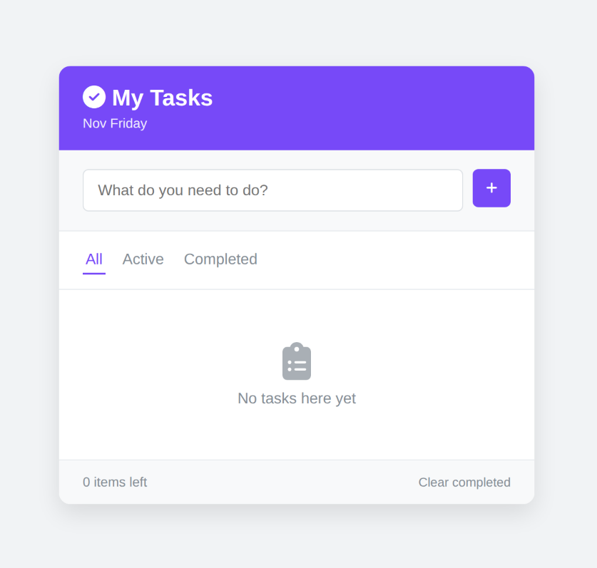
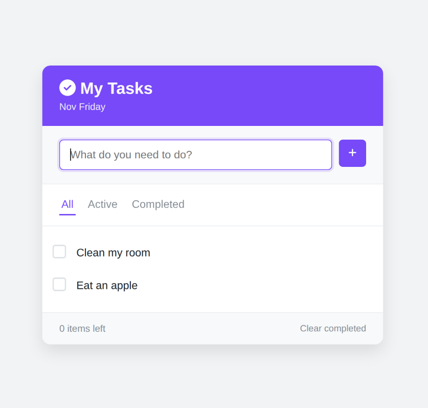
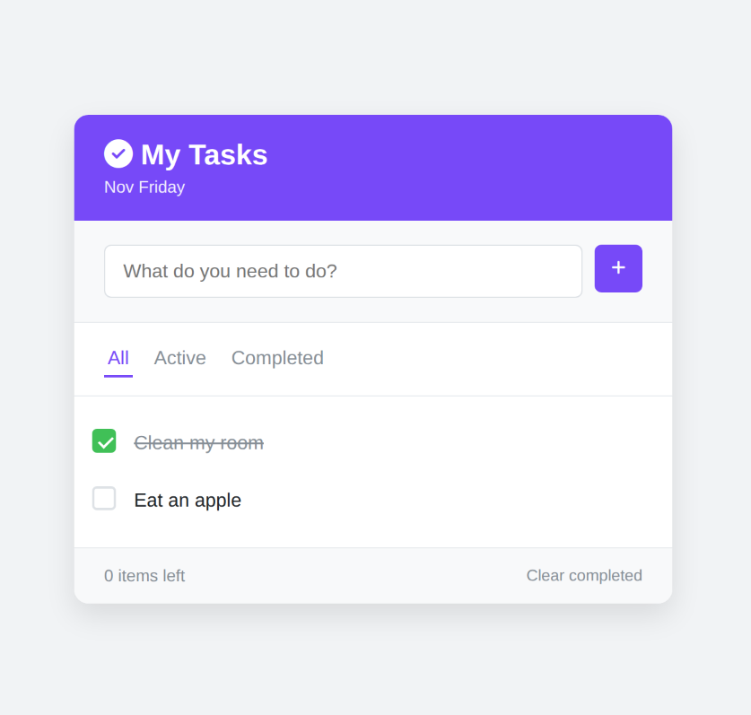
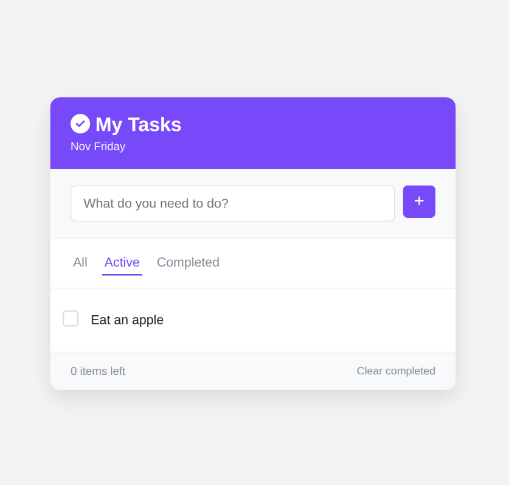
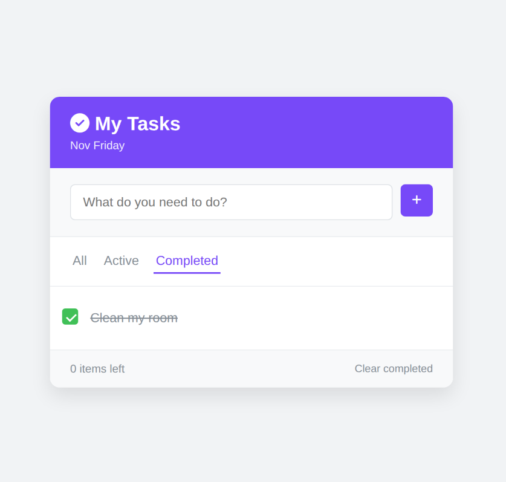

## About This Project
A clean, interactive **Todo List App** built with HTML, CSS, and vanilla JavaScript. It features dynamic task management, status filtering, a live item counter, current date display, and persistent browser storage using `localStorage`.

## How It Works
1. **Task Management:** Users can add new tasks (via button click or the `Enter` key), mark tasks as completed with a custom checkbox, or delete individual items.
2. **Filtering & Cleanup:** Tasks can be filtered dynamically by **All**, **Active**, or **Completed** views, and finished tasks can be bulk-removed using the **Clear completed** button.
3. **State & Persistence:** All tasks are saved to `localStorage` so they remain after page reloads, while the UI automatically updates the remaining task counter and toggles an empty-state placeholder when no tasks are present.

## Screenshots

